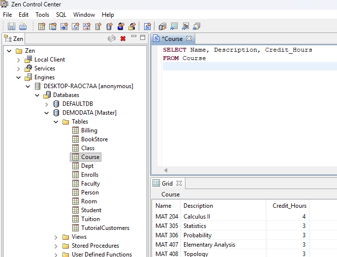

# Hello World with Actian Zen

*Tutorial 1: Install the tools, connect to Zen, and run your first C++ query.*

## Introduction
Whether you're new to Actian Zen or have experience using the database but haven't developed an application with it, this step-by-step tutorial will help you get started.
Zen is a high-performance, embedded database designed to support applications that need reliable, efficient data access.
In this first tutorial, we'll get a Windows development environment running, connect to Zen's sample **DEMODATA** database using ODBC, and display records from its `Course` table in a simple console application.

By the end, you'll know how to:

- Install Visual Studio and the Zen database engine.
- Create, compile, and run a C++ console application.
- Open an ODBC connection to Zen.
- Run a SQL query, read its results, and handle a basic error.
- Close the database connection and release ODBC resources.

We're using **Windows, Visual Studio Community, C++, and Zen Enterprise Server v17 AI**. C++ makes it easy to show the ODBC API directly, but these ideas apply to C and many other languages. Other editions of Zen may work too. We're installing the AI-capable edition because later tutorials will explore vector search; **this first example does not use AI or require an AI model**.

You don't need to know C++ particularly well to follow along. Familiarity with basic SQL helps. Here’s how to get started:

## 1. Install Visual Studio Community

1. Visit the [Visual Studio downloads page](https://visualstudio.microsoft.com/downloads/) and download **Visual Studio Community 2026**.
2. Run the installer.
3. Under **Workloads**, select **Desktop development with C++**. The default optional components are fine for this tutorial.
4. Complete the installation and launch Visual Studio. You can sign in with a Microsoft account or skip sign-in if offered.

That's all the development tooling we need. This first application uses Windows' ODBC API, so there's **no third-party C++ library or NuGet package to install**.

### Check that C++ works

Before introducing the database, let's make sure the compiler is working.

1. On Visual Studio's start screen, choose **Create a new project**.
2. Search for **Console App**. Choose the template with **C++** as the language and **Windows** as the platform.
3. Select **Next**, name the project `HelloZen1`, choose a location, and select **Create**.
4. Open `HelloZen1.cpp` and replace its contents with:

```cpp
#include <iostream>

int main() {
    std::cout << "Hello from Zen Tutorial!\n";
}
```

Press **Ctrl+F5** (*Start Without Debugging*). You should see:

```text
Hello from Zen Tutorial!
```

Congratulations, your C++ development environment works. Now let's give the application a database to talk to.

## 2. Install Actian Zen

[Download **Actian Zen Enterprise Server v17 AI for Windows**](https://www.actian.com/databases/zen/downloads/). Follow the licensing instructions provided with the download; a trial or valid license may be required.

Run the Enterprise Server installer, and follow the wizard. For this tutorial, the **Complete** installation is the simplest option. You should have administrator privileges on the Windows computer. Leave the default data-access components and **Zen Control Center (ZenCC)** selected.

The installation includes the Zen engine, ODBC connectivity, administration tools, and sample data.

For more details, see [Installing Zen Enterprise Server on Windows](https://docs.actian.com/zen/v17/getstart/02instnt.htm).

### Verify the sample database

1. Open **Zen Control Center** from the Windows Start menu.
2. Expand the local Zen server and its databases.
3. Find **DEMODATA**, the sample database installed with Zen. Expand its tables and locate `Course`.
4. If you'd like, open a SQL editor in ZenCC and try:

```sql
SELECT Name, Description, Credit_Hours FROM Course;
```

You should get several courses back. That's the same query we're about to run from C++.



## 3. Connect to Zen from C++

Return to Visual Studio and replace `HelloZen1.cpp` with the complete example below. This is the working version used in the [HelloZen repository](https://github.com/actian-devs/HelloZenAI/tree/main/HelloZen1). The complete program is shown below so you can copy, compile, and run it right away. In Section 4, we'll break it down into smaller pieces and explain how each part works.

```cpp
#include <iostream>
#include <windows.h>
#include <sql.h>
#include <sqlext.h>
#include <string>
#pragma comment(lib, "odbc32.lib")

// Table definition for the Course table in Zen's DEMODATA database:
/*
CREATE TABLE "Course" IN DICTIONARY USING 'Course.mkd' PAGESIZE=4096 (
    "Name" CHAR(7) NOT NULL CASE,
    "Description" CHAR(50) CASE,
    "Credit_Hours" USMALLINT,
    "Dept_Name" CHAR(20) NOT NULL CASE
);
*/

int main() {
    SQLHENV env;
    SQLHDBC db;
    SQLHSTMT stmt;

    // Initialize ODBC.
    SQLAllocHandle(SQL_HANDLE_ENV, SQL_NULL_HANDLE, &env);
    SQLSetEnvAttr(env, SQL_ATTR_ODBC_VERSION, (SQLPOINTER)SQL_OV_ODBC3, 0);
    SQLAllocHandle(SQL_HANDLE_DBC, env, &db);

    // Connect to Zen's DEMODATA database (no DSN required).
    SQLCHAR connection[] = "Driver={Pervasive ODBC Interface};DBQ=DEMODATA;";
    // DEMODATA does not require credentials, but for databases that do:
    // SQLCHAR connection[] = "Driver={Pervasive ODBC Interface};DBQ=myDatabaseName;UID=myUser;PWD=myPassword;";

    if (!SQL_SUCCEEDED(SQLDriverConnectA(db, nullptr, connection,
        SQL_NTS, nullptr, 0, nullptr, SQL_DRIVER_NOPROMPT))) {
        std::cerr << "Connection failed!\n";
        SQLFreeHandle(SQL_HANDLE_DBC, db);
        SQLFreeHandle(SQL_HANDLE_ENV, env);
        return 1;
    }

    // Query the Course table.
    SQLAllocHandle(SQL_HANDLE_STMT, db, &stmt);
    SQLCHAR query[] = "SELECT Name, Description, Credit_Hours FROM Course";

    SQLRETURN result = SQLExecDirectA(stmt, query, SQL_NTS);

    // Check for errors.
    if (!SQL_SUCCEEDED(result)) {
        // Display the SQL error returned by ODBC.
        SQLCHAR state[6], message[256];
        SQLINTEGER code;
        SQLSMALLINT length;

        if (SQL_SUCCEEDED(SQLGetDiagRecA(SQL_HANDLE_STMT, stmt, 1,
            state, &code, message, sizeof(message), &length)))
            std::cerr << "Query failed: " << message << "\n";
    } else {
        SQLCHAR name[8], description[51];
        SQLUSMALLINT creditHours;
        SQLLEN descLength, creditLength;

        // Read and display each row.
        while (SQL_SUCCEEDED(SQLFetch(stmt))) {
            SQLGetData(stmt, 1, SQL_C_CHAR, name, sizeof(name), nullptr);
            SQLGetData(stmt, 2, SQL_C_CHAR, description, sizeof(description), &descLength);
            SQLGetData(stmt, 3, SQL_C_USHORT, &creditHours, sizeof(creditHours), &creditLength);

            if (descLength == SQL_NULL_DATA)
                description[0] = '\0';

            std::cout << name << ": " << description;

            // Credit hours could be null; show 'unavailable' if so.
            std::cout << (creditLength == SQL_NULL_DATA
                ? " (credits unavailable)\n"
                : " (" + std::to_string(creditHours) + " credits)\n");
        }
    }

    // Clean up.
    SQLFreeHandle(SQL_HANDLE_STMT, stmt);
    SQLDisconnect(db);
    SQLFreeHandle(SQL_HANDLE_DBC, db);
    SQLFreeHandle(SQL_HANDLE_ENV, env);
}
```

Press **Ctrl+F5** again. If everything is installed and connected correctly, the program will display course names, descriptions, and credit hours from DEMODATA.

## 4. Understand the code

You don't need to memorize the entire ODBC API. There are a few operations worth recognizing.

### Include the ODBC headers and library

```cpp
#include <windows.h>
#include <sql.h>
#include <sqlext.h>
#pragma comment(lib, "odbc32.lib")
```

The headers declare the Windows and ODBC types and functions. The `#pragma` tells Visual Studio to link the Windows ODBC library, avoiding a separate linker setting for this example.

### Initialize ODBC and connect

```cpp
SQLAllocHandle(SQL_HANDLE_ENV, SQL_NULL_HANDLE, &env);
SQLSetEnvAttr(env, SQL_ATTR_ODBC_VERSION, (SQLPOINTER)SQL_OV_ODBC3, 0);
SQLAllocHandle(SQL_HANDLE_DBC, env, &db);
```

ODBC uses **handles** to represent an environment, a database connection, and individual SQL statements. Here we're creating the first two. We then connect with:

```cpp
SQLCHAR connection[] = "Driver={Pervasive ODBC Interface};DBQ=DEMODATA;";
SQLDriverConnectA(db, nullptr, connection,
    SQL_NTS, nullptr, 0, nullptr, SQL_DRIVER_NOPROMPT);
```

We supply the installed driver name and database name. `SQL_NTS` tells ODBC the string is null-terminated. The `A` suffix selects the ANSI character version of the API (as opposed to SQLDriverConnectW, which uses UTF-16).

In production, the connection string may also need a server address and credentials. (Avoid storing real passwords in committed source code).

### Execute a SQL query

```cpp
SQLCHAR query[] = "SELECT Name, Description, Credit_Hours FROM Course";
SQLRETURN result = SQLExecDirectA(stmt, query, SQL_NTS);
```

Once the statement handle has been allocated, `SQLExecDirectA` sends our SQL directly to Zen.

### Read the results

```cpp
while (SQL_SUCCEEDED(SQLFetch(stmt))) {
    // SQLGetData reads the columns in the current row.
}
```

`SQLFetch` advances to the next row, and `SQLGetData` copies column values into C++ variables. In our example:

- `Name` is `CHAR(7)`, so the buffer has **8 bytes**, including the terminating null character.
- `Description` is `CHAR(50)`, so the buffer has **51 bytes**.
- `Credit_Hours` is Zen's `USMALLINT`, retrieved as `SQL_C_USHORT` into a C++ unsigned short.

We also check `SQL_NULL_DATA` for the nullable columns, so a missing description displays as blank and missing credit hours display as *credits unavailable*.

### Handle errors

`SQL_SUCCEEDED()` tests whether an ODBC call succeeded. If the query fails, `SQLGetDiagRecA()` retrieves a diagnostic message from the statement handle. Try temporarily changing `Course` to a nonexistent table name to see the error handling in action, then change it back.

The current program prints a simple message for connection failures and more detail for query failures. A production application should also check handle allocation, data retrieval, and fetch errors, report connection diagnostics, and decide whether retrying is appropriate.

### Clean up

```cpp
SQLFreeHandle(SQL_HANDLE_STMT, stmt);
SQLDisconnect(db);
SQLFreeHandle(SQL_HANDLE_DBC, db);
SQLFreeHandle(SQL_HANDLE_ENV, env);
```

We free the statement, disconnect, and release the connection and environment handles. ODBC allocates resources outside ordinary C++ objects, so it's important to release them.

The `?` is a **parameter marker**. With ODBC, we'd use `SQLPrepare`, `SQLBindParameter`, and `SQLExecute` to supply the department safely and separately from the SQL. We'll use that pattern in the next tutorial, where we build a small **Create, Read, Update, Delete (CRUD)** application.

## 5. Troubleshooting

| What you see | What to check |
|---|---|
| No **Console App (C++)** template | Open Visual Studio Installer and add **Desktop development with C++**. |
| Can't find `sql.h` or link `odbc32.lib` | Verify the C++ desktop workload and Windows SDK components are installed. |
| `Connection failed!` | Confirm Zen is running, `DEMODATA` appears in ZenCC, The ODBC driver is normally installed automatically with Zen. |
| Query fails | Run the same `SELECT` statement in ZenCC and check the ODBC diagnostic message. |

## 7. Try it yourself

Now that the application works, make a small change and press **Ctrl+F5** again. Try selecting fewer columns, adding `ORDER BY Name`, or exploring the `Dept` and `Class` tables in ZenCC.

You've taken the first step toward building database applications with Actian Zen. You now know how to connect to a Zen database, execute SQL queries, retrieve data and handle basic errors using C++ and ODBC.
These foundational skills open the door to building applications that do more than simply retrieve information. You can begin developing applications that interact with data, support business processes and take advantage of Zen's embedded database capabilities.
Your first application is just the beginning.
**Next up: CRUD with ODBC**, including parameterized queries and inserting, updating, and deleting records.

### References

- [Visual Studio Community download](https://visualstudio.microsoft.com/downloads/)
- [Microsoft: Create a C++ console application](https://learn.microsoft.com/en-us/visualstudio/ide/getting-started-with-cpp-in-visual-studio)
- [Actian: Installing Zen Enterprise Server on Windows](https://docs.actian.com/zen/v17/getstart/02instnt.htm)
- [Actian: Zen v17 ODBC API support](https://docs.actian.com/zen/v17/odbc/intro.htm)
- [Actian Zen v17 documentation](https://docs.actian.com/zen/v17/)

